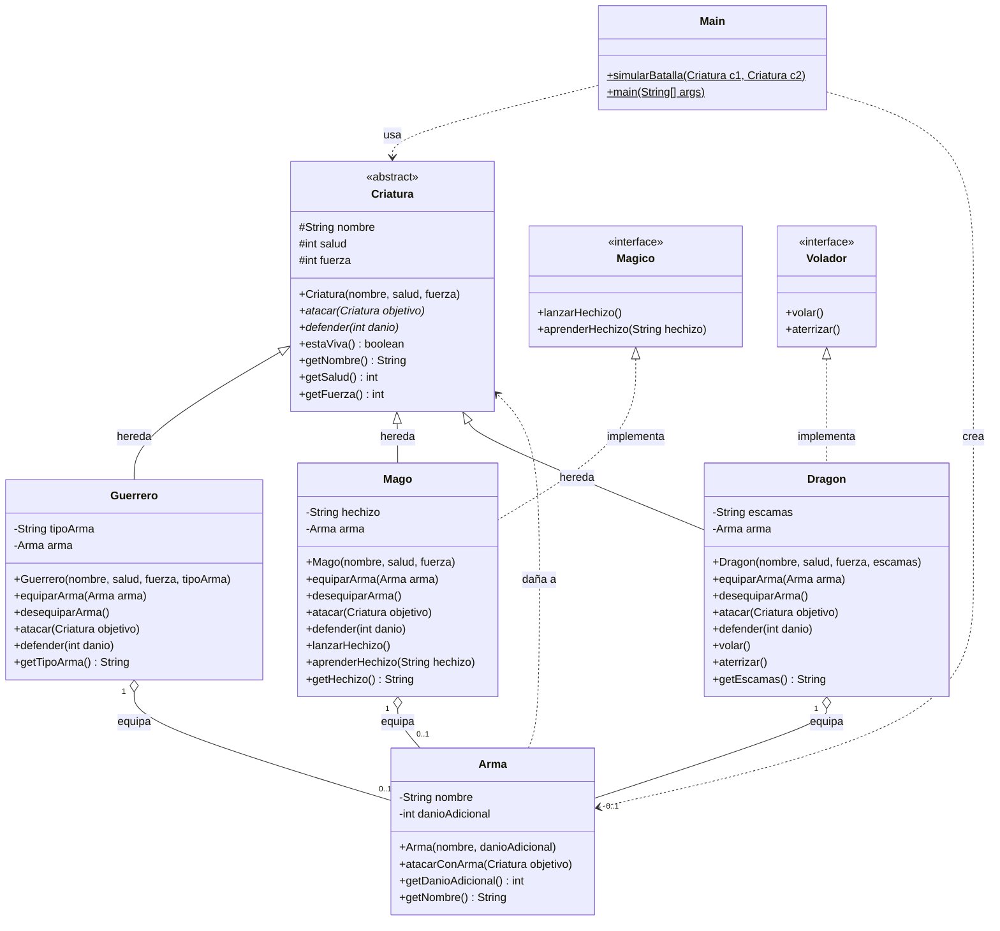
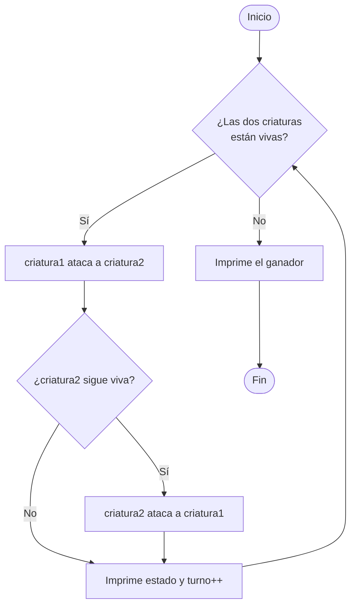

# Parcial-II-Practica-411

Examen Programación 2

**Integrantes**

- Eduar Andres Renteria Balverde
- Juan Felipe Bustamante Caicedo

**Grupo 411**

> Cada integrante creó sus clases por separado en su propia rama. En la rama principal (`main`) está el proyecto completo con todas las clases unidas.

---

## 1. ¿De qué trata el proyecto?

**Batalla de Criaturas** es un simulador de combate por turnos escrito en Java 17 con Maven. Hay tres tipos de criaturas (Guerrero, Mago y Dragón) que pueden equiparse un arma y pelear entre sí hasta que una de las dos se queda sin salud.

El proyecto sirve para practicar los pilares de la programación orientada a objetos:

| Concepto POO | Dónde se ve en el código |
|---|---|
| **Abstracción** | `Criatura` es una clase abstracta con `atacar()` y `defender()` sin implementar |
| **Herencia** | `Guerrero`, `Mago` y `Dragon` extienden `Criatura` |
| **Polimorfismo** | `Main.simularBatalla(Criatura, Criatura)` llama a `atacar()` sin saber qué tipo de criatura es |
| **Interfaces** | `Magico` (lo implementa `Mago`) y `Volador` (lo implementa `Dragon`) |
| **Composición / asociación** | Cada criatura *tiene un* `Arma` (opcional) |
| **Encapsulamiento** | Atributos `private`/`protected` y acceso mediante getters |

---

## 2. Estructura del proyecto

```
batalla-criaturas/
├── pom.xml
└── src/
    ├── main/java/com/taller/batallas/
    │   ├── Main.java                  ← simulación de la batalla
    │   ├── armas/Arma.java
    │   ├── criaturas/
    │   │   ├── Criatura.java          ← clase abstracta
    │   │   ├── Guerrero.java
    │   │   ├── Mago.java
    │   │   └── Dragon.java
    │   └── interfaces/
    │       ├── Magico.java
    │       └── Volador.java
    └── test/java/com/taller/batallas/
        ├── AppTest.java               ← prueba de ejemplo de Maven
        ├── CriaturaTest.java          ← 3 pruebas originales
        ├── ArmaTest.java              ← pruebas 1 y 2
        ├── GuerreroTest.java          ← pruebas 3, 4 y 5
        ├── MagoTest.java              ← prueba 6
        ├── DragonTest.java            ← pruebas 7 y 8
        └── BatallaTest.java           ← pruebas 9 y 10
```

---

## 3. Diagrama UML

El diagrama está escrito en [Mermaid](https://mermaid.js.org/), por lo que GitHub lo dibuja automáticamente al abrir este archivo.



**Cómo leerlo**

- Flecha con triángulo vacío y línea continua → **herencia** (`extends`).
- Flecha con triángulo vacío y línea punteada → **implementación de interfaz** (`implements`).
- Rombo vacío → **agregación**: la criatura guarda un arma, pero el arma existe por sí sola y puede quitarse (`0..1` significa que puede no tener).
- Flecha punteada → **dependencia**: una clase usa a otra como parámetro, sin guardarla.

---

## 4. Cómo funciona

### 4.1 Reglas del combate

| Criatura | Daño que causa al atacar | Extra |
|---|---|---|
| **Guerrero** | `fuerza` | — |
| **Mago** | `fuerza` | Hechizo inicial "Bola de energía"; puede aprender otros |
| **Dragón** | `fuerza × 2` | Puede volar y aterrizar |

Si la criatura tiene un arma equipada, después de su ataque normal el arma aplica **su propio daño adicional**. Por ejemplo, el Guerrero Conan (fuerza 15) con la Espada Legendaria (+5) hace 20 de daño por turno.

Al recibir daño, `defender()` resta la salud y la deja **mínimo en 0**, nunca negativa. Una criatura está viva mientras `salud > 0`.

### 4.2 Flujo de `simularBatalla`



Detalle importante: si la criatura 2 muere con el primer golpe, **ya no contraataca**.

### 4.3 Cómo se construyó (paso a paso)

1. **Se diseñó la jerarquía.** Lo común (nombre, salud, fuerza, `estaViva()`) se puso en la clase abstracta `Criatura`. Lo que cambia según el tipo (`atacar`, `defender`) quedó como método abstracto.
2. **Se crearon las interfaces** `Magico` y `Volador` para capacidades que solo tienen algunas criaturas.
3. **Se crearon las clases hijas.** Cada una implementa su propia forma de atacar y defender, y agrega sus atributos propios (`tipoArma`, `hechizo`, `escamas`).
4. **Se creó `Arma`** como clase independiente y se relacionó con las criaturas por agregación.
5. **Se escribió `Main`** con `simularBatalla()` (recibe dos `Criatura`, lo que permite polimorfismo) y un `main()` de demostración.
6. **Se escribieron las pruebas con JUnit 5** para verificar cada regla.
7. **Trabajo en equipo:** cada integrante desarrolló sus clases en su rama de Git y luego se unieron en `main`.

---

## 5. Pruebas unitarias (JUnit 5)

Se agregaron **10 pruebas nuevas** (más las 3 de `CriaturaTest` y la de `AppTest` que ya existían, para un total de 14).

| # | Clase | Prueba | Qué verifica |
|---|---|---|---|
| 1 | `ArmaTest` | `prueba01_armaGuardaNombreYDanio` | El constructor guarda nombre y daño adicional |
| 2 | `ArmaTest` | `prueba02_atacarConArmaReduceSaludDelObjetivo` | El arma resta exactamente su daño al objetivo (50 → 44) |
| 3 | `GuerreroTest` | `prueba03_atacarSinArmaCausaSoloFuerza` | Sin arma el daño es solo la fuerza (100 → 85) |
| 4 | `GuerreroTest` | `prueba04_atacarConArmaSumaDanioAdicional` | Con arma el daño es fuerza + arma (100 → 80) |
| 5 | `GuerreroTest` | `prueba05_desequiparArmaQuitaElBonus` | Al desequipar se pierde el bonus (100 → 85) |
| 6 | `MagoTest` | `prueba06_magoAprendeHechizo` | Hechizo por defecto y cambio con `aprenderHechizo` |
| 7 | `DragonTest` | `prueba07_dragonCausaDobleDeFuerza` | El dragón hace `fuerza × 2` (100 → 60) |
| 8 | `DragonTest` | `prueba08_saludNuncaEsNegativa` | La salud se queda en 0 y `estaViva()` es `false` |
| 9 | `BatallaTest` | `prueba09_simularBatallaTerminaConUnGanador` | La batalla termina, gana el dragón y el guerrero no contraataca |
| 10 | `BatallaTest` | `prueba10_polimorfismoEInterfaces` | `instanceof` de `Volador`/`Magico` y polimorfismo de `atacar()` |

### Cómo se escribieron

- Cada prueba usa el patrón **Arrange – Act – Assert**: se crean los objetos, se ejecuta la acción y se comprueba el resultado con `assertEquals`, `assertTrue` o `assertFalse`.
- Los valores esperados se calcularon a mano a partir de las reglas del combate (por ejemplo, `100 − (15 + 5) = 80`), así que cada prueba es determinista y no depende del azar.
- Los métodos están numerados (`prueba01_`, `prueba02_`…) para que sea fácil ubicarlos en el reporte.

### Cómo ejecutarlas

Con Maven instalado, desde la carpeta `batalla-criaturas`:

```bash
mvn test
```

Resultado esperado:

```
Tests run: 14, Failures: 0, Errors: 0, Skipped: 0
BUILD SUCCESS
```

En IntelliJ o VS Code también se pueden ejecutar con clic derecho sobre la carpeta `src/test/java` → *Run Tests*.

---

## 6. Ejecutar el programa

```bash
cd batalla-criaturas
mvn compile exec:java -Dexec.mainClass="com.taller.batallas.Main"
```

(o ejecutar `Main.java` directamente desde el IDE). Simula la batalla **Smaug (Dragón) vs Conan (Guerrero)**.

---

## 7. Posibles mejoras

- `equiparArma`, `desequiparArma`, `defender` y el atributo `arma` están **repetidos** en las tres clases hijas. Se podrían subir a `Criatura` para evitar duplicación.
- `equiparArma(null)` lanza `NullPointerException` por el `getNombre()` posterior; convendría validar el parámetro.
- Agregar ataques críticos o defensa/armadura para que la batalla sea más variada.
